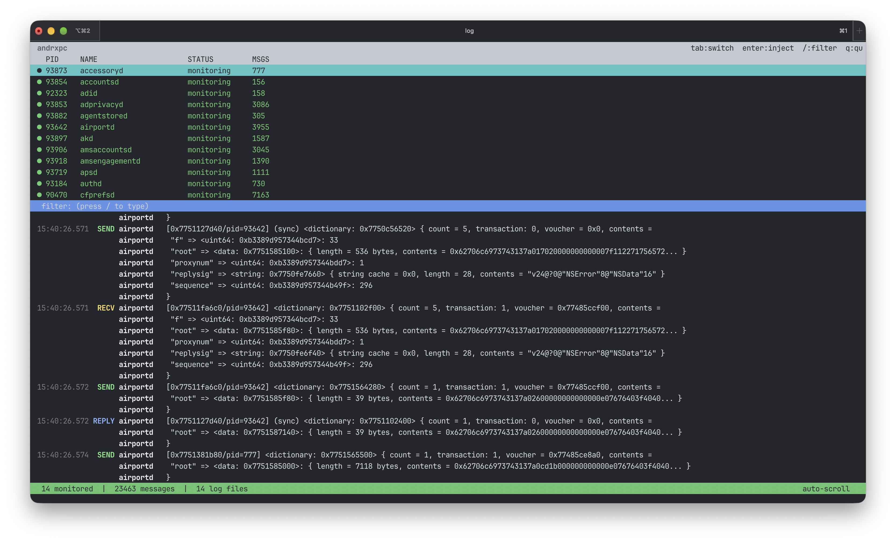

# andrxpc

Universal XPC message interceptor for macOS. Hooks all IPC channels (XPC, NSXPC, Mach bootstrap, CFMessagePort, distributed notifications) in any process, including sandboxed daemons, with a real-time ncurses TUI.



## What it does

- **xpchook.dylib** - intercepts XPC connections, messages, replies, bootstrap lookups, CFMessagePort calls, NSXPCConnection lifecycle, and NSDistributedNotificationCenter posts. Logs everything to `/tmp/andrxpc/` (or `/Library/Apple/usr/lib/andrxpc_logs/` for sandboxed processes, or os_log as a last resort).
- **injector** - injects the hook dylib into running processes using `processor_set_tasks` (PST) for task port acquisition and remote `dlopen` via a custom arm64e trampoline. Handles sandbox extensions, `__RESTRICT` binaries, and `checked-allocations` entitlement via ptrace fallback.
- **andrxpc** (TUI) - ncurses interface that lists all processes, lets you inject into any of them, and shows intercepted XPC messages in real-time with color-coded tags.

## Requirements

- macOS on Apple Silicon (arm64e)
- SIP disabled (`csrutil disable` from Recovery)
- AMFI disabled (boot-args: `amfi_get_out_of_my_way=1 amfi_allow_any_signature=1`)
- Root access

## Building

```bash
make
```

Produces:
- `build/xpchook.dylib` - the hook library (auto-codesigned with ad-hoc signature)
- `build/injector` - the CLI injector
- `build/andrxpc` - the TUI monitor

If you want to codesign manually:

```bash
codesign -f -s - build/xpchook.dylib
codesign -f -s - build/injector
codesign -f -s - build/andrxpc
```

## Usage

### TUI (recommended)

```bash
sudo build/andrxpc
```

The TUI shows:
- **Top panel** - process list with monitoring status and message counts. Processes with active hooks show a green dot.
- **Middle bar** - filter input (press `/` to type a filter, Enter/Esc to confirm)
- **Bottom panel** - real-time log stream with color-coded message types

Controls:
| Key | Action |
|-----|--------|
| Tab | Switch focus between process list and log view |
| Enter | Open inject menu for selected process |
| / | Enter filter mode |
| c | Clear filter |
| y | Copy visible logs to clipboard (pbcopy) |
| G | Jump to bottom (re-enable auto-scroll) |
| Up/Down | Navigate / scroll |
| PgUp/PgDn | Page scroll in log view |
| Mouse scroll | Scroll in the panel under cursor |
| q | Quit |

The inject menu (Enter on a process) offers:
1. **dlopen inject** - injects via remote thread creation + dlopen. Works on all processes including `__RESTRICT` binaries. Only hooks NSXPC (ObjC swizzle).
2. **Restart with all hooks** - kills the process and relaunches it with `DYLD_INSERT_LIBRARIES` (or via `launchctl debug` for daemons). Hooks everything (XPC C API, NSXPC, bootstrap, CFMessagePort, distributed notifications). Won't work on `__RESTRICT` binaries - the TUI warns you.

### CLI injector

```bash
# inject into a process by PID
sudo build/injector -p <pid> build/xpchook.dylib

# inject by process name
sudo build/injector -n <name> build/xpchook.dylib

# kill + restart with DYLD_INSERT_LIBRARIES
sudo build/injector -r <name> build/xpchook.dylib

# restart a launchd daemon with hooks (launchctl debug)
sudo build/injector -d <label> build/xpchook.dylib

# inject into all processes
sudo build/injector -a build/xpchook.dylib

# list all processes with PST task port status
sudo build/injector -l
```

### Filter syntax

The filter supports multiple space-separated tokens (AND logic):

- `pid:1234` - filter by PID
- `tag:SEND` - filter by message tag (INIT, CONN, SEND, RECV, REPLY, BOOT, NSXPC, CFMP, DNOTE, EVENT)
- `port:0x1234` - filter by Mach port in message text
- `anything else` - case-insensitive substring match against message text, process name, or tag

Example: `tag:SEND accountsd` - shows only SEND messages from accountsd.

## How injection works

1. **Task port** - acquired via `processor_set_tasks` (PST). This bypasses `task_for_pid` restrictions.
2. **Remote symbol resolution** - reads the target's `dyld_all_image_infos`, walks Mach-O load commands and symbol tables to find `dlopen`, `dlerror`, `_pthread_set_self`, and `sandbox_extension_consume` in the target's address space.
3. **Sandbox extensions** - if the target is sandboxed, issues file-read and file-map-executable sandbox extensions for the dylib path.
4. **Staging** - copies the dylib to `/Library/Apple/usr/lib/` and re-codesigns it (ad-hoc), so sandboxed processes can load it.
5. **Trampoline** - allocates RX memory in the target, writes a compact arm64e shellcode that: calls `_pthread_set_self`, consumes sandbox extensions (if any), calls `dlopen`, stores the result, calls `dlerror` on failure, and spins (`B .`) when done.
6. **Thread** - creates a new thread in the target via `thread_create_running`, waits for it to hit the spin instruction, reads the result, and cleans up.

For `checked-allocations` processes, falls back to `ptrace(PT_ATTACH)` before thread creation.

For launchd daemons (`-d` mode), uses `launchctl debug <target> --environment DYLD_INSERT_LIBRARIES=<path>` + `launchctl kill SIGTERM` + `launchctl kickstart` for a one-shot restart with full interposition.

## Log format

```
HH:MM:SS.mmm   TAG process    message
```

Tags: INIT, CONN, SEND, RECV, REPLY, BOOT, NSXPC, CFMP, DNOTE, EVENT

## Tested on

- macOS 27.3 beta 1 (Sequoia)
- Apple Silicon: M4 Pro (T6041)
- SIP disabled, AMFI disabled
- Verified with system daemons (accountsd, adid, mediaremoted, etc.)
- Stress-tested with ~4000 messages in real-time streaming

## MCP server

andrxpc has an MCP (Model Context Protocol) server so AI assistants like Claude can read XPC logs, inject into processes, and monitor traffic directly.

### Setup

Add to your Claude Code config (`~/.claude/settings.json`):

```json
{
  "mcpServers": {
    "andrxpc": {
      "command": "python3",
      "args": ["/path/to/andrxpc/mcp/server.py"]
    }
  }
}
```

Replace `/path/to/andrxpc` with the actual path. No dependencies needed, just python3.

### Tools

| Tool | Description |
|------|-------------|
| `status` | log file count, total messages, monitored processes |
| `logs` | read intercepted XPC messages with optional filter, process, tag |
| `log_files` | list active log files with size and modification time |
| `inject` | inject xpchook.dylib into a process (dlopen/restart/daemon) |
| `processes` | list all processes with PST task port status |

### Example

After setup, you can ask Claude things like:
- "show me recent XPC messages from accountsd"
- "inject into airportd and show me what it sends"
- "how many XPC messages did adid send?"
- "filter logs for bootstrap lookups"

`inject` and `processes` require root - run Claude Code under sudo or the injector will fail.

## Contributing

<sub>If you want to help - open an issue or submit a pull request. Bug reports, new ideas, support for other architectures, better TUI, whatever. All contributions welcome.</sub>

## License

MIT
